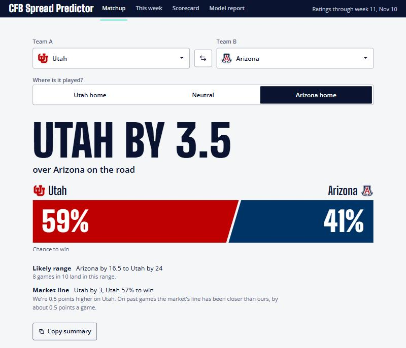
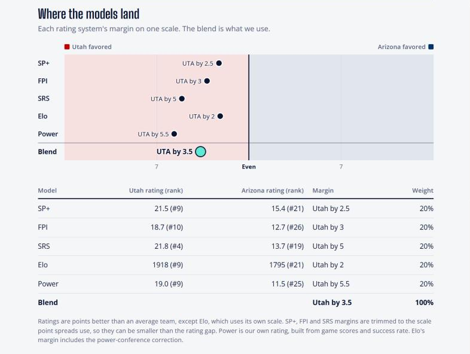
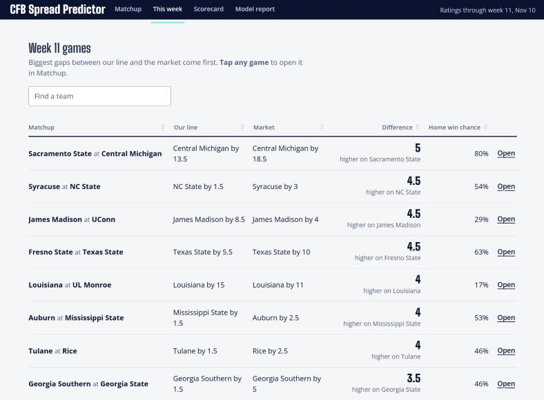

# CFB Spread Predictor

[](https://github.com/tgilbert14/spread-predictor/actions/workflows/tests.yml)
[](https://github.com/tgilbert14/spread-predictor/actions/workflows/snapshot.yml)

Pick any two FBS college football teams and get a spread and a win
probability, on a neutral field or at either team's home.

The number is a blend of five rating systems: four public ones (SP+, FPI, SRS
and Elo) and our own Power rating, built from game scores and success rate. The app shows where
each one lands, so you can see when they disagree.



Under the answer, the app shows where each rating system lands, so
disagreement is easy to see.



The This week tab lists every game, sorted by how far our number is from the
market's.



The Scorecard tab keeps the model honest. Every week, before the first
kickoff, the app's line for every game is saved and never changed. Once the
games are played, each saved line is graded against the final score and
against the market line saved with it: how far off we were, how far off the
market was, how often we picked the winner, and how the games went when we
disagreed with the market by 3 or more points. It also grades all five rating
systems on the same games.

> This app was made in collaboration with AI (Claude by Anthropic).

## Contents

- [Try it in two minutes](#try-it-in-two-minutes)
- [Use real data](#use-real-data)
- [Keep it up to date](#keep-it-up-to-date)
- [How the number is made](#how-the-number-is-made)
- [What's in the repo](#whats-in-the-repo)
- [Troubleshooting](#troubleshooting)
- [Limits](#limits)
- [Credits](#credits)

## Try it in two minutes

You need [R](https://cran.r-project.org/) 4.2 or newer. No API key yet.

```bash
git clone https://github.com/tgilbert14/spread-predictor.git
cd spread-predictor
Rscript scripts/setup.R
Rscript -e "shiny::runApp(launch.browser = TRUE)"
```

The app opens in **demo mode** with made-up teams (Saguaro State, Sonoran
Tech and friends). Everything works. The numbers just aren't real.

## Use real data

Four steps, about ten minutes. You do this once.

**1. Get a free API key.** Sign up at
[collegefootballdata.com](https://collegefootballdata.com/key). The key
arrives by email.

**2. Save the key where R can find it.** Create a file named `.Renviron` in
the project folder with this one line:

```
CFBD_API_KEY=paste-your-key-here
```

`.Renviron` is in `.gitignore`, so the key never gets committed.

**3. Pull the history and fit the model.**

```bash
Rscript scripts/backfill.R      # past seasons: games, lines, ratings (about 70 API calls)
Rscript scripts/pull_extras.R   # past seasons: talent, returning production, game stats (about 30 calls)
Rscript scripts/fit.R           # builds the database, fits the model, prints a report
```

**4. Take this week's snapshot and build the app data.**

```bash
Rscript scripts/refresh.R
```

Run the app again. The demo banner is gone and you're looking at real teams.

Prefer RStudio? Open `Spread-predictor.Rproj` and run each script with
`source()`, for example `source("scripts/backfill.R")`.

## Keep it up to date

Ratings change every week, and three of the four public systems don't publish their
history. If a week isn't saved, it's gone. So the repo saves it for you.

### Automatic refresh (recommended)

A GitHub Action refreshes the data three times a week and commits the
results: snapshot files, the app data, and the saved predictions. Turn it on
once:

1. On GitHub, open the repo's **Settings > Secrets and variables > Actions**.
2. Click **New repository secret**.
3. Name it `CFBD_API_KEY` and paste your key.

That's it. To test it right away, open the **Actions** tab, choose
**Weekly snapshot**, and click **Run workflow**.

The weekly rhythm (times are UTC):

| When | What happens |
|---|---|
| Tuesday 13:00 | New ratings, games and lines. This week's predictions are saved before the first kickoff, and last week's are graded. |
| Thursday and Friday 21:00 | Lines refreshed, so the app shows how far each has moved since Tuesday. Game notes (injuries, weather) are added to `data/notes.csv` on these days by a separate check. |

Each run does the same thing: `Rscript scripts/refresh.R`. It never rewrites
a saved predictions file, and it only saves one before the week's first game
kicks off.

**Run workflow** also offers these tasks:

| Task | What it does |
|---|---|
| `refresh` | The default, as above |
| `extras` | Pulls research data: talent, returning production, game stats |
| `backfill` | Pulls history for every season, plus the research data |
| `fit` | Refits the model (`data/params.json`), then rebuilds the app data |
| `manifest` | Writes `manifest.json`, the file list a Posit Connect or shinyapps.io server needs to deploy the app |

### Updating your local copy

```bash
git pull
Rscript scripts/refresh.R --offline
```

`--offline` rebuilds the database and app data from the snapshot files without
calling the API.

### What each script does

| Script | What it does | Calls the API? |
|---|---|---|
| `scripts/setup.R` | Installs R packages and checks your key | No |
| `scripts/backfill.R` | One-time pull of past seasons | Yes, about 70 calls |
| `scripts/fit.R` | Rebuilds the database, fits the model, writes `data/params.json` | No |
| `scripts/snapshot.R` | Saves this week's ratings, games, lines and game stats (plus the season's talent and returning production the first time) | Yes, about 9 calls (12 the first week of a season) |
| `scripts/refresh.R` | Snapshot, rebuild the database and app data, save this week's predictions before kickoff, grade saved ones, audit | Yes, unless `--offline` |
| `scripts/backtest.R` | Re-tests the model and candidate factors, writes `docs/backtest-results.md` | No |
| `scripts/audit.R` | Checks every table for duplicates, bad scores, odd lines and gaps, writes `docs/data-audit.md` | No |
| `scripts/pull_extras.R` | One-time pull of past seasons' talent, returning production and game stats | Yes, about 30 calls once |
| `scripts/write_manifest.R` | Writes `manifest.json` for deploying the app (needs the `rsconnect` package) | No |

The free API tier allows 1,000 calls a month. The three automatic runs use
about 20 a week (later runs in a week skip ratings already saved).

## How the number is made

1. **Each system gives a margin.** SP+, FPI and SRS rate teams in points, so
   the margin is one team's rating minus the other's. Elo isn't in points, so
   its gap is divided by a scale factor, and it gets a correction because it
   undersells the gap between power-conference teams and everyone else.
   Power is our own rating, computed week by week from scores and from how
   consistently each team wins its downs (success rate).
2. **Early in the season, Elo and Power get preseason help.** Roster talent
   and how much of last season's production is coming back add points in
   week 1, fading to nothing by week 7. SP+ and FPI already include their own
   preseason view, so they get nothing extra.
3. **Home field is added** when the game isn't on a neutral field.
4. **The five margins are averaged.** Right now each counts equally. Fitted
   weights only replace equal ones if they prove better on data the fit never
   saw.
5. **The margin becomes a win probability** using how far real games tend to
   land from predictions.

The scale factors, the power-conference correction, the preseason points,
home field and the typical miss are fit on 2018, 2019 and 2021 to 2025 using
each team's Elo and Power ratings from *before* kickoff (2017 warms up the
Power rating, and the 2020 COVID season is skipped). The current season is
held out as an honest test. That matters. Fitting on end-of-season ratings
would mean grading the model on answers it had already seen.

More detail: [docs/how-it-works.md](docs/how-it-works.md).

## What's in the repo

```
app.R                 the Shiny app
R/                    all functions (pipeline, model, app modules)
scripts/              the commands you run (see the table above)
sql/                  database schema and queries
data/snapshots/       weekly ratings, games, lines, extras and saved predictions as CSV. The source of truth.
data/params.json      fitted model parameters
data/app_data.rds     everything the app shows, built from the files above
data/notes.csv        game notes (injuries, weather), added during the week
tests/testthat/       unit tests
docs/                 deeper documentation
.github/workflows/    weekly snapshot and test automation
```

`cfb.sqlite` is built, not stored. Delete it any time.
`data/app_data.rds` is built too, but it is committed, because the hosted app
needs it. `Rscript scripts/refresh.R --offline` makes both again.

Further reading:

- [docs/how-it-works.md](docs/how-it-works.md): the model and pipeline in plain language
- [docs/data-dictionary.md](docs/data-dictionary.md): every file, table and column
- [docs/backtest-results.md](docs/backtest-results.md): the latest backtest, generated by `scripts/backtest.R`
- [docs/data-audit.md](docs/data-audit.md): the latest data quality report, generated on every refresh
- [docs/research-log.md](docs/research-log.md): ideas tested by hand with outside data, and what happened
- [docs/PLAN.md](docs/PLAN.md): the original build plan and the reasoning behind it

To run the tests:

```bash
Rscript -e 'testthat::test_dir("tests/testthat")'
```

## Troubleshooting

| You see | Do this |
|---|---|
| A "Demo data" banner | `data/app_data.rds` doesn't exist yet. Follow [Use real data](#use-real-data). |
| `CFBD_API_KEY is not set` | Check that `.Renviron` is in the project folder, then restart R. |
| `params.json` not found | Run `Rscript scripts/fit.R` first. |
| "Ratings are more than 8 days old" | Run `git pull`, then `Rscript scripts/refresh.R --offline`. |
| A column-name error from a `normalize_` function | The `cfbfastR` package changed its output. The message lists the columns it got. Open an issue with that message. |
| The GitHub Action fails | Check that the `CFBD_API_KEY` secret exists and that you have API calls left this month. |

## Limits

- FBS teams only.
- No injuries, weather or roster news in the number. The line is what the
  rating systems know. Game notes and line movement show news next to it,
  but never change it.
- A few weeks on the Scorecard is too little to judge the model. Single games
  swing by two touchdowns, so give it a season.
- Early in the season, ratings lean on preseason guesses. The app flags this.
- Ratings stop updating once bowl season starts. Games and lines still
  refresh.
- The betting market is the benchmark, and it's hard to beat. Expect this
  tool to be a little less accurate than the closing line. Its value is that
  it prices any matchup, including games that will never be played.
- This is not betting advice.

## Credits

- Data from [CollegeFootballData.com](https://collegefootballdata.com/),
  accessed with the [cfbfastR](https://cfbfastr.sportsdataverse.org/) package.
- SP+ is by Bill Connelly. FPI is by ESPN. SRS and Elo are as published by
  CollegeFootballData.com.
- Fonts: Big Shoulders Display and Instrument Sans, both under the SIL Open
  Font License. The files and licenses are in `www/fonts/`.
- Made in collaboration with AI (Claude by Anthropic). See
  [CITATION.cff](CITATION.cff) for how to cite this project.

## License

[MIT](LICENSE)
