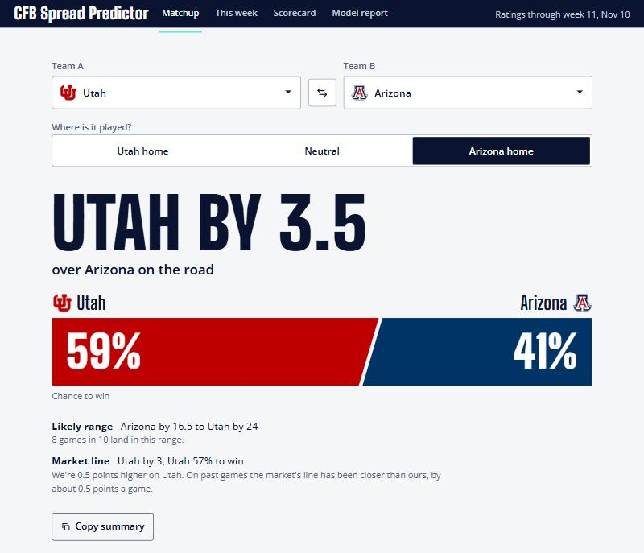
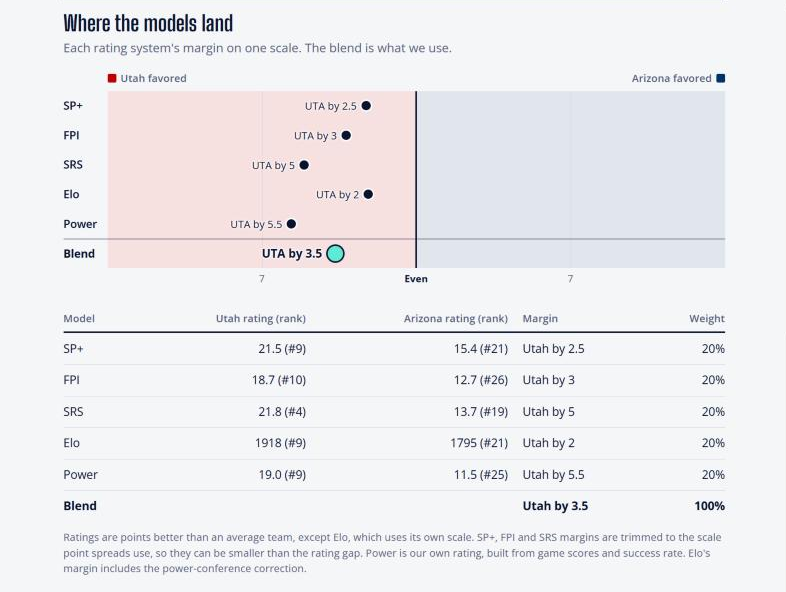
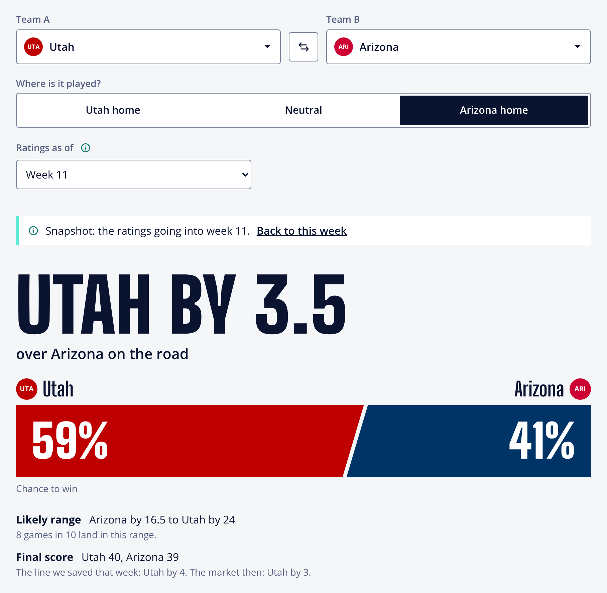
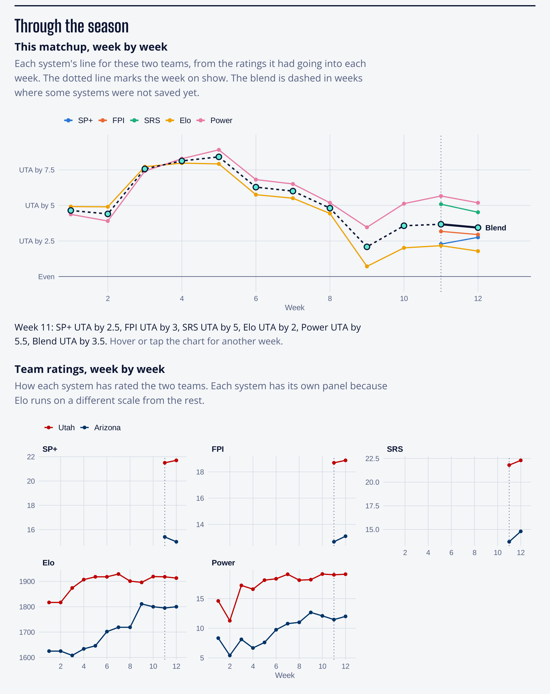
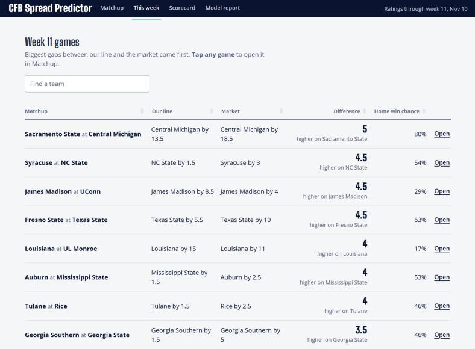
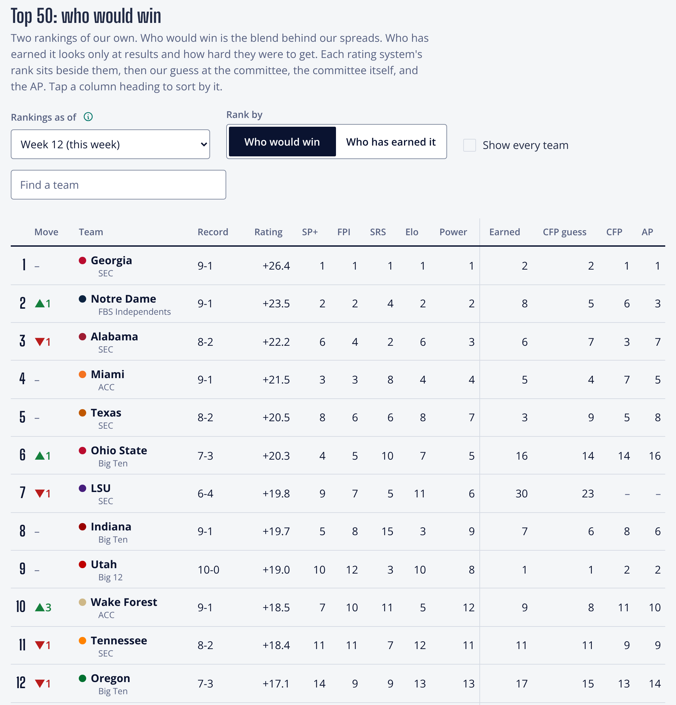
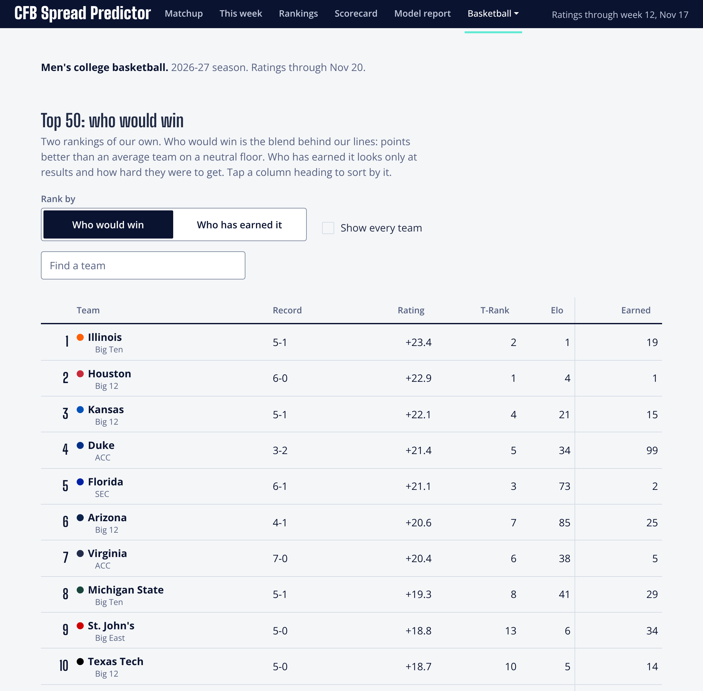
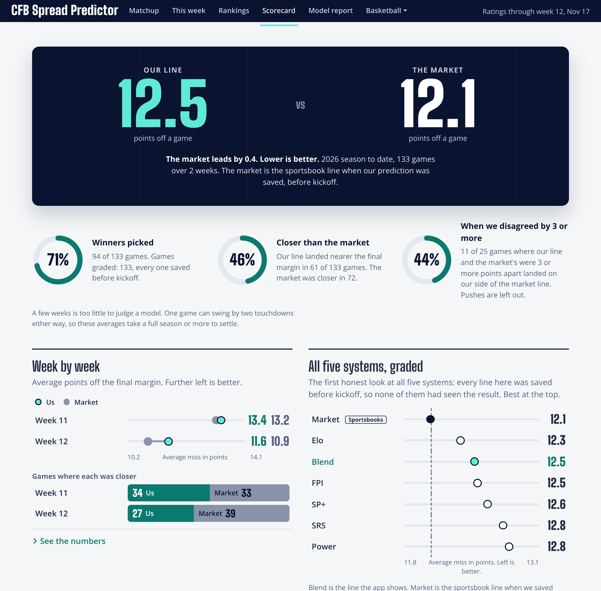

# CFB Spread Predictor

[](https://github.com/tgilbert14/spread-predictor/actions/workflows/tests.yml)
[](https://github.com/tgilbert14/spread-predictor/actions/workflows/snapshot.yml)

Pick any two FBS college football teams and get a spread and a win
probability, on a neutral field or at either team's home.

**[Open the live app](https://01a1c5e7-cc4d-e36c-e94b-154a1b6d62e7.share.connect.posit.cloud)**.
It runs on Posit Connect Cloud and republishes itself whenever the data
refreshes.

The number is a blend of five rating systems: four public ones (SP+, FPI, SRS
and Elo) and our own Power rating, built from game scores and success rate. The app shows where
each one lands, so you can see when they disagree.



Under the answer, the app shows where each rating system lands, so
disagreement is easy to see.



**Ratings as of** turns the Matchup tab into a snapshot of an earlier week.
Pick a week and the app answers with the ratings the systems had going into
that week's games. If the two teams played that week, it shows the final
score and the line we saved at the time.



Under that, two charts follow the matchup through the season: each system's
line for these two teams week by week, and each team's rating in every
system.



The This week tab lists every game, sorted by how far our number is from the
market's.



The Rankings tab is our Top 50, two ways. A switch picks which one the
list is ranked by.

- **Who would win.** The same blend that sets the spreads: how many points
  better than an average team each one is on a neutral field. The gap
  between two teams on the list is our neutral-site line for them.
- **Who has earned it.** Results only. Each win counts for more the better
  the opponent and the harder the site, measured against what a top-10
  team would do with the same schedule. No credit for winning big and no
  bonus for a conference.

Each rating system's own rank sits beside them, with how far each team
moved since last week. The last columns are the playoff committee, the AP,
and **our CFP guess**, our prediction of the committee's ranking.

**Last game and next game.** A switch above the Top 50, the committee
prediction and the basketball Top 50 swaps the ranking columns for each
team's last result, or its next game with our line for it (and the
sportsbooks' line when we hold one). Each opponent shows its logo and
ranking. Looking back at an earlier week, it shows that week's game and how
it finished.

**Team pages.** Tap a team's name in the Top 50, the committee prediction
or the projected field to open its page: record, where it ranks in the
polls and in our two rankings, its Power rating week by week, its poll
history, and every game, with our line on the ones still to play.

**Toss-ups and the Group of Six race.** In the committee prediction, two
neighbors the model has nearly level are tagged as a toss-up. Under the
projected field, the Group of Six race lists the teams in line for the one
bid that goes to the best team from the six smaller conferences.

**Share a game.** Each game on This week has a share button. On a phone it
opens the share sheet; elsewhere it copies a sentence with our line and a
link that opens the game.

**Rankings beside names.** Wherever a team is named in a matchup (This
week, the Matchup header, the Scorecard), a small number shows the playoff
committee's latest ranking, or the AP poll before the committee starts.
Basketball has no poll in our data, so it shows our own top 25.

**Where the app opens.** On This week, unless a link names a matchup. Once
a week's games are all played, This week looks ahead to the next week's
games, marked "Look ahead".

**The betting line beside ours.** Every game we hold a sportsbook line for
shows it next to our line: on This week (including the look-ahead), in the
Next game view of the rankings, on team pages and on the Matchup tab. The
data refresh saves lines for every unplayed game, not only this week's.

**Predicting the committee.** Every week, as soon as the weekend's games
are final, the app saves its prediction of the committee's next ranking.
Once the real ranking is out, the prediction is never changed: it is
graded and added to a running record on the Rankings tab.

The prediction starts from what earlier committees did and learns this
season's emphasis from each new ranking, since the 2026 rules kept the
same ingredients but changed their weight. Its biggest lesson: the
committee starts from its own last ranking, then moves teams for new
losses, for how much their record improved and for wins over ranked teams.
Two habits are applied after the scores: head-to-head decides between
close teams within a few places of each other, and a ranked team that
wins drops at most one place. A No. 1 that keeps winning stays No. 1, and
once the title games are played the real conference champions take their
bids. The info button beside "Predicting the
committee" lists what it has learned, each with a real example, and
`docs/committee-notes.md` keeps the full reasoning and weights on record.
What a season learns is saved and carried into the next one.

**Projected playoff field.** The 2026 bid rules applied to our predicted
ranking: the four Power Four champions, the best team from the other six
conferences, Notre Dame if it is in the top 12, and the best of the rest,
seeded straight from the ranking, with the first-round games. Until a
conference's title game is played, its best team in our prediction stands
in as the "leader". After that, the real champion takes the bid.



The **Basketball** menu does the same for men's college basketball: a
Matchup page, the next few days' games against the market, and a Top 50
ranked both ways (who would win, and who has earned it). See
[Basketball](#basketball) below.



The Scorecard tab keeps the model honest. Every week, before the first
kickoff, the app's line for every game is saved and never changed. Once the
games are played, each saved line is graded against the final score and
against the market line saved with it: how far off we were, how far off the
market was, how often we picked the winner, and how the games went when we
disagreed with the market by 3 or more points. It also grades all five rating
systems on the same games.

It reads as charts first: a scoreboard with our average miss next to the
market's, rings for the hit rates, every system on one scale, and for any
graded week the games where we or the market got closest. Tap a game for
both lines and the final score. The tables are folded under each chart.
The Model report tab works the same way.



> This app was made in collaboration with AI (Claude by Anthropic).

## Contents

- [Try it in two minutes](#try-it-in-two-minutes)
- [Use real data](#use-real-data)
- [Keep it up to date](#keep-it-up-to-date)
- [Basketball](#basketball)
- [How the number is made](#how-the-number-is-made)
- [What's in the repo](#whats-in-the-repo)
- [Troubleshooting](#troubleshooting)
- [Limits](#limits)
- [Credits](#credits)

## Try it in two minutes

You need [R](https://cran.r-project.org/) 4.2 or newer. No API key yet.

```bash
git clone https://github.com/tgilbert14/spread-predictor.git
cd spread-predictor
Rscript scripts/setup.R
Rscript -e "shiny::runApp(launch.browser = TRUE)"
```

The app opens in **demo mode** with made-up teams (Saguaro State, Sonoran
Tech and friends). Everything works. The numbers just aren't real.

## Use real data

Four steps, about ten minutes. You do this once.

**1. Get a free API key.** Sign up at
[collegefootballdata.com](https://collegefootballdata.com/key). The key
arrives by email.

**2. Save the key where R can find it.** Create a file named `.Renviron` in
the project folder with this one line:

```
CFBD_API_KEY=paste-your-key-here
```

`.Renviron` is in `.gitignore`, so the key never gets committed.

**3. Pull the history and fit the model.**

```bash
Rscript scripts/backfill.R      # past seasons: games, lines, ratings (about 70 API calls)
Rscript scripts/pull_extras.R   # past seasons: talent, returning production, game stats (about 30 calls)
Rscript scripts/fit.R           # builds the database, fits the model, prints a report
```

**4. Take this week's snapshot and build the app data.**

```bash
Rscript scripts/refresh.R
```

Run the app again. The demo banner is gone and you're looking at real teams.

Prefer RStudio? Open `Spread-predictor.Rproj` and run each script with
`source()`, for example `source("scripts/backfill.R")`.

## Keep it up to date

Ratings change every week, and three of the four public systems don't publish their
history. If a week isn't saved, it's gone. So the repo saves it for you.

### Automatic refresh (recommended)

A GitHub Action refreshes the data three times a week and commits the
results: snapshot files, the app data, and the saved predictions. Turn it on
once:

1. On GitHub, open the repo's **Settings > Secrets and variables > Actions**.
2. Click **New repository secret**.
3. Name it `CFBD_API_KEY` and paste your key.

That's it. To test it right away, open the **Actions** tab, choose
**Weekly snapshot**, and click **Run workflow**.

The weekly rhythm (times are UTC):

| When | What happens |
|---|---|
| Tuesday 13:00 | New ratings, games and lines. This week's predictions are saved before the first kickoff, and last week's are graded. |
| Tuesday 18:00 | The same run again, as a safety net. If the first one failed, the week's predictions are still saved before the first kickoff. Saved files are never rewritten. |
| Thursday and Friday 21:00 | Lines refreshed, so the app shows how far each has moved since Tuesday. Game notes (injuries, weather) are added to `data/notes.csv` on these days by a separate check. |
| Sunday and Monday 14:00 | Results only. The weekend's games are in, so our prediction of the committee's next ranking is saved, and last week's game predictions are graded. No new ratings: the public systems may not have updated yet, and a ratings snapshot is never rewritten. |
| Wednesday 14:00 | Results only. Picks up the committee's ranking from Tuesday night, so our prediction of it is graded. |
| Every day 14:23, November to April | Basketball: new games, lines and T-Rank ratings, and the day's predictions saved before tipoff. See [Basketball](#basketball). |

Each run does the same thing: `Rscript scripts/refresh.R`. It never rewrites
a saved predictions file, and it only saves one before the week's first game
kicks off.

**Run workflow** also offers these tasks:

| Task | What it does |
|---|---|
| `refresh` | The default, as above |
| `results` | New results, lines and polls only. No ratings snapshot and no game predictions saved. What the Sunday, Monday and Wednesday runs do. |
| `extras` | Pulls research data: talent, returning production, game stats |
| `backfill` | Pulls history for every season, plus the research data |
| `fit` | Refits the model (`data/params.json`), rebuilds the app data, then reruns the backtest and the spread study |
| `manifest` | Writes `manifest.json`, the file list a Posit Connect or shinyapps.io server needs to deploy the app |
| `basketball` | Refreshes basketball: games, lines and T-Rank ratings, its app data, and today's saved predictions |

### Updating your local copy

```bash
git pull
Rscript scripts/refresh.R --offline
```

`--offline` rebuilds the database and app data from the snapshot files without
calling the API.

### What each script does

| Script | What it does | Calls the API? |
|---|---|---|
| `scripts/setup.R` | Installs R packages and checks your key | No |
| `scripts/backfill.R` | One-time pull of past seasons | Yes, about 70 calls |
| `scripts/fit.R` | Rebuilds the database, fits the model, writes `data/params.json` | No |
| `scripts/snapshot.R` | Saves this week's ratings, games, lines, game stats and poll rankings (plus the season's talent and returning production the first time) | Yes, about 10 calls (13 the first week of a season) |
| `scripts/refresh.R` | Snapshot, rebuild the database and app data, save this week's predictions before kickoff, grade saved ones, audit | Yes, unless `--offline` |
| `scripts/backtest.R` | Re-tests the model and candidate factors, writes `docs/backtest-results.md` | No |
| `scripts/audit.R` | Checks every table for duplicates, bad scores, odd lines and gaps, writes `docs/data-audit.md` | No |
| `scripts/pull_extras.R` | One-time pull of past seasons' talent, returning production and game stats | Yes, about 30 calls once |
| `scripts/disagreement.R` | Counts which side covered when a model and the sportsbooks disagreed on the spread, and writes `docs/market-disagreement.md` | No |
| `scripts/write_manifest.R` | Writes `manifest.json` for deploying the app, trimmed to the packages the app uses (needs the `rsconnect` package) | No |

The free API tier allows 1,000 calls a month. The football runs use about
35 a week (later runs in a week skip ratings already saved). The
daily basketball run uses the same key and adds about 60 a month.

### Start of a new season

Once a year, before week 1, tell the model that last season is now history.
Until you do, the app still works, but it is running on settings that never
learned from last season. Do this in August or later. Before August the code
still treats last season as the current one and won't pull its final ratings.

1. In `R/config.R`, add last season to `TRAINING_SEASONS` and `FIT_SEASONS`.
   For the 2027 season that means `TRAINING_SEASONS <- 2017:2026` and
   `FIT_SEASONS <- c(2018L, 2019L, 2021:2026)`. `HOLDOUT_SEASON` follows on
   its own.
2. Update the season lists in this README (How the number is made) and in
   [docs/how-it-works.md](docs/how-it-works.md) (Seasons) to match.
3. Commit, push, and check that the tests pass.
4. On the **Actions** tab, run **Weekly snapshot** with the task `backfill`.
   It pulls last season's final ratings and skips everything already saved.
5. Run it again with the task `fit`. That refits the model with last season
   included and rebuilds the app data.
6. Run it once more with the default task, `refresh`, and check that it
   finishes green and the new season's files show up in `data/snapshots/`.
7. The committee weights carry over on their own: the new season starts
   from what last season learned (`data/committee_learned.json`). To start
   from every past season instead, add last season to `SEASONS` in
   `scripts/committee_prior.R` and run it.
8. Check the playoff rules in `PLAYOFF` in `R/config.R`. The field grows to
   24 teams in 2027, so the bids and byes there need updating, and
   `docs/cfp-guidelines.md` with them.

## Basketball

Basketball lives in the same app, under the **Basketball** menu, with its
own data in `data/basketball/` and its own code in the `R/cbb_*.R` files.
Nothing in football depends on it. Without `data/basketball/app_data.rds`
the menu simply does not show.

**How the line is made.** Two rating systems, blended.

- **T-Rank** (barttorvik.com) rates each team's offense and defense per 100
  possessions, and its pace. The margin is the efficiency gap times the
  possessions the two teams would play, so the same edge is worth more
  points in a faster game.
- **Elo** comes with each game from the API.

The scales, home court (3.3 points) and the blend weight were fit on the
2024-25 season: 97% T-Rank, 3% Elo. Fit on games before mid-January and
checked on the 2,589 after, the blend missed by 8.6 points a game against
the market's 8.4.

**Refresh it by hand.** It uses the same `CFBD_API_KEY` as football and
draws on the same 1,000 calls a month. A refresh is 2 calls.

```bash
Rscript scripts/cbb_refresh.R             # pull, rebuild, save today's predictions
Rscript scripts/cbb_refresh.R --offline   # rebuild from the files on disk
Rscript scripts/cbb_fit.R                 # refit the model on last season
```

It also runs on its own every morning from November to April (14:23 UTC,
9:23am Eastern), once yesterday's T-Rank file is out and before the day's
first tipoff. To run it by hand on GitHub: **Actions > Weekly snapshot >
Run workflow**, task `basketball`.

Elo is the weak half. The API starts every team level each fall and it
swings hard on early results, so its ranks look odd until midseason. It
carries 3% of the line.

**One rule to know.** A T-Rank file dated the 20th is taken after the
20th's games. So a game on the 20th is predicted from the 19th's file.
`cbb_ratings_before()` is the only place ratings are looked up, and it
enforces that. Getting it wrong makes the model look better than the
betting market, which it is not.

**What is saved.** Each day's predictions are written once, before tipoff,
to `data/basketball/predictions/`, the way football's are each week. There
is no basketball Scorecard page yet. The files are there so one can be
built on an honest record.

## How the number is made

1. **Each system gives a margin.** SP+, FPI and SRS rate teams in points, so
   the margin is one team's rating minus the other's. Elo isn't in points, so
   its gap is divided by a scale factor, and it gets a correction because it
   undersells the gap between power-conference teams and everyone else.
   Power is our own rating, computed week by week from scores and from how
   consistently each team wins its downs (success rate).
2. **Early in the season, Elo and Power get preseason help.** Roster talent
   and how much of last season's production is coming back add points in
   week 1, fading to nothing by week 7. SP+ and FPI already include their own
   preseason view, so they get nothing extra.
3. **Home field is added** when the game isn't on a neutral field.
4. **The five margins are averaged.** Right now each counts equally. Fitted
   weights only replace equal ones if they prove better on data the fit never
   saw.
5. **The margin becomes a win probability** using how far real games tend to
   land from predictions.

The scale factors, the power-conference correction, the preseason points,
home field and the typical miss are fit on 2018, 2019 and 2021 to 2025 using
each team's Elo and Power ratings from *before* kickoff (2017 warms up the
Power rating, and the 2020 COVID season is skipped). The current season is
held out as an honest test. That matters. Fitting on end-of-season ratings
would mean grading the model on answers it had already seen.

More detail: [docs/how-it-works.md](docs/how-it-works.md).

## What's in the repo

```
app.R                 the Shiny app
R/                    all functions (pipeline, model, app modules)
scripts/              the commands you run (see the table above)
scripts/research/     one-off tests of ideas that did not make the model
sql/                  database schema and queries
data/snapshots/       weekly ratings, games, lines, extras and saved predictions as CSV. The source of truth.
data/params.json      fitted model parameters
data/app_data.rds     everything the app shows, built from the files above
data/notes.csv        game notes (injuries, weather), added during the week
data/basketball/      basketball: games, daily T-Rank ratings, saved predictions, fitted parameters, app data
tests/testthat/       unit tests
docs/                 deeper documentation
.github/workflows/    weekly snapshot and test automation
```

`cfb.sqlite` is built, not stored. Delete it any time.
`data/app_data.rds` is built too, but it is committed, because the hosted app
needs it. `Rscript scripts/refresh.R --offline` makes both again.

Further reading:

- [docs/how-it-works.md](docs/how-it-works.md): the model and pipeline in plain language
- [docs/data-dictionary.md](docs/data-dictionary.md): every file, table and column
- [docs/backtest-results.md](docs/backtest-results.md): the latest backtest, generated by `scripts/backtest.R`
- [docs/data-audit.md](docs/data-audit.md): the latest data quality report, generated on every refresh
- [docs/research-log.md](docs/research-log.md): every idea that was tested and left out, with the numbers
- [docs/cfp-guidelines.md](docs/cfp-guidelines.md): the playoff committee's 2026 rules and metrics, and what they mean for our prediction
- [docs/committee-notes.md](docs/committee-notes.md): what this season's committee rankings have taught the model, rewritten on every refresh
- [docs/market-disagreement.md](docs/market-disagreement.md): which side covered when a model and the sportsbooks disagreed, generated by `scripts/disagreement.R`
- [docs/PLAN.md](docs/PLAN.md): the original build plan and the reasoning behind it

To run the tests:

```bash
Rscript -e 'testthat::test_dir("tests/testthat")'
```

## Troubleshooting

| You see | Do this |
|---|---|
| A "Demo data" banner | `data/app_data.rds` doesn't exist yet. Follow [Use real data](#use-real-data). |
| `CFBD_API_KEY is not set` | Check that `.Renviron` is in the project folder, then restart R. |
| `params.json` not found | Run `Rscript scripts/fit.R` first. |
| "Ratings are more than 8 days old" | Run `git pull`, then `Rscript scripts/refresh.R --offline`. |
| A column-name error from a `normalize_` function | The `cfbfastR` package changed its output. The message lists the columns it got. Open an issue with that message. |
| The GitHub Action fails | Check that the `CFBD_API_KEY` secret exists and that you have API calls left this month. |
| The scheduled runs stopped on their own | GitHub turns off schedules on a repo with no commits for 60 days. Open the **Actions** tab, choose **Weekly snapshot**, click **Enable workflow**, then **Run workflow**. |
| The app opens on a game you don't care about | Set `FEATURED_TEAM` in `R/config.R` to your school. Its game opens first each week. With no game left to play, the app opens on the game between the two strongest teams. |

## Limits

- FBS teams only.
- Snapshots only reach back as far as the saved ratings. SP+, FPI and SRS
  were first saved in week 11 of 2026, so earlier weeks that season show Elo
  and Power only. A snapshot uses that week's ratings with today's model
  settings, so it can differ a little from the line saved that week.
- No injuries, weather or roster news in the number. The line is what the
  rating systems know. Game notes and line movement show news next to it,
  but never change it.
- A few weeks on the Scorecard is too little to judge the model. Single games
  swing by two touchdowns, so give it a season.
- Early in the season, ratings lean on preseason guesses. The app flags this.
- Ratings stop updating once bowl season starts. Games and lines still
  refresh.
- The betting market is the benchmark, and it's hard to beat. Expect this
  tool to be a little less accurate than the closing line. Its value is that
  it prices any matchup, including games that will never be played.
- "Who would win" and "who has earned it" are different questions, so the
  two rankings disagree, sometimes by a lot. A team with a perfect record
  and close wins ranks high on earned and lower on would-win. That is on
  purpose.
- The earned-it ranking judges a schedule by our Power rating of each
  opponent, so it is only as good as that rating. It knows nothing about
  head-to-head results or conference titles.
- This is not betting advice.

## Credits

- Data from [CollegeFootballData.com](https://collegefootballdata.com/),
  accessed with the [cfbfastR](https://cfbfastr.sportsdataverse.org/) package.
- SP+ is by Bill Connelly. FPI is by ESPN. SRS and Elo are as published by
  CollegeFootballData.com.
- Fonts: Big Shoulders Display and Instrument Sans, both under the SIL Open
  Font License. The files and licenses are in `www/fonts/`.
- Made in collaboration with AI (Claude by Anthropic). See
  [CITATION.cff](CITATION.cff) for how to cite this project.

## License

[MIT](LICENSE)
